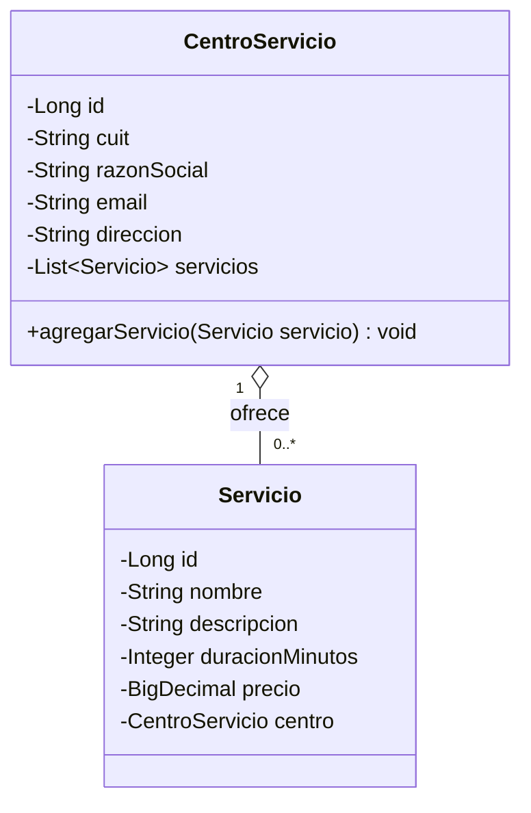

# Referencia consolidada — Aplicaciones Interactivas (UADE)

Documento único con todo lo trabajado para el parcial/TPO de la materia:
convenciones de la cátedra + caso resuelto de ejemplo (TurnoGo) + prompt
de arranque para minimizar tokens. Pensado para pegarse como contexto
inicial en cualquier sesión nueva, sin depender de tener el repo clonado.

---

## 1. Convenciones de la cátedra

Extraídas del código de referencia del docente (dominio DeliveryGo).
Usar como checklist rápido: reemplazar los nombres genéricos por las
entidades del enunciado que toque, manteniendo el patrón.

### ⚠️ Reglas críticas (el profesor las evalúa con más peso)

El profesor pone el foco explícitamente en **cohesión y acoplamiento**,
**consistencia e integridad de los datos**, y en el **orden** en que se
pasan y validan los datos. Estos puntos son los que más rápido bajan la
nota si se rompen:

1. **Nunca exponer una `@Entity` fuera del Service.** El Controller nunca
   recibe ni devuelve una Entity; siempre un DTO. Pasar una Entity
   directamente (al Controller, al `@RequestBody`, o devolverla en un
   `ResponseEntity`) es el error que el profesor considera **fatal**: acopla
   el contrato HTTP al modelo de persistencia y rompe la cohesión de capas.
   - Entity ⇄ DTO se traduce **siempre dentro del Service** (o de un mapper
     interno del Service), nunca en el Controller ni en el Repository.
2. **Orden de las operaciones dentro de un método `@Transactional` del
   Service** (ver `ServicioServices.registrarServicio` / `ProductoServices
   .createProducto` como referencia):
   1. Buscar/validar que las dependencias externas existan (ej. el padre de
      una relación N:1, un CUIT/email que deba ser único).
   2. Validar las reglas de negocio propias del dato a crear (formato,
      rangos, obligatoriedad) — en un método **privado** del Service.
   3. Recién ahí construir la Entity y, si corresponde, asociarla a su
      padre (`padre.agregarHijo(hijo)` para mantener la relación
      bidireccional sincronizada en memoria).
   4. Persistir con el Repository.
   5. Devolver el DTO (nunca la Entity).
   - Si se invierte el orden (ej. guardar antes de validar, o asociar la
     relación antes de confirmar que el padre existe) se rompe la
     integridad: puede quedar un registro persistido a medias o una
     relación inconsistente aunque después se lance la excepción.
3. **Cohesión por capa, responsabilidad única:**
   - `Entity` → solo representa estado persistente e invariantes mínimas.
   - `Repository` → solo *finders*, cero lógica de negocio.
   - `Service` → orquesta el caso de uso completo (buscar, validar,
     persistir, transaccionar). Es la única capa que conoce tanto Entities
     como DTOs.
   - `Controller` → solo traduce HTTP ↔ Service, nunca decide reglas de
     negocio ni llama a un Repository directo.
   - Si una capa necesita hacer algo que "no le toca" (ej. el Controller
     validando un dato, o el Repository con un `if` de negocio), es una
     señal de acoplamiento indebido.
4. **Integridad a nivel de base**, no solo de negocio: toda restricción de
   negocio relevante (unicidad, obligatoriedad, relación obligatoria) debe
   reflejarse también en la Entity (`@Column(unique = true, nullable =
   false)`, `@JoinColumn(nullable = false)`), no solo validarse en el
   Service. Las dos capas de defensa son necesarias.
5. **Trazabilidad entre artefactos:** los mismos nombres de entidades,
   atributos y relaciones tienen que aparecer en el Caso de Uso, el
   Diagrama de Clases, el DER y el código. Un cambio de nombre en una
   entidad que no se refleja en los cuatro lugares es inconsistencia.

### Reglas generales

- **Sin Lombok.** Getters/setters explícitos.
- **DTOs planos**, no records. Van en `dto/`.
- **Sin excepciones custom.** Se usa `IllegalArgumentException` para toda
  violación de regla de negocio.
- **Transaccionalidad:** `jakarta.transaction.Transactional` (¡no
  `org.springframework.transaction.annotation.Transactional`!).
- Las **reglas de negocio se validan en el Service**, nunca en el
  Repository ni en el Controller.
- El `DemoDataLoader` **siempre pasa por los Services**, nunca llama a un
  Repository directamente.

### Entity (`model/`)

```java
@Entity
@Table(name = "nombre_tabla")
public class MiEntidad {

    @Id
    @GeneratedValue(strategy = GenerationType.IDENTITY)
    private Long id;

    @Column(nullable = false, unique = true)
    private String campoUnico;

    @Column(nullable = false)
    private String campoObligatorio;

    // 1:N -> LAZY explícito, sin cascade
    @OneToMany(mappedBy = "padre", fetch = FetchType.LAZY)
    private List<Hijo> hijos = new ArrayList<>();

    // N:1 -> sin fetch explícito (default EAGER)
    @ManyToOne
    @JoinColumn(name = "padre_id", nullable = false)
    private Padre padre;

    // Constructor vacío OBLIGATORIO: Hibernate instancia por reflexión
    // antes de poblar los campos.
    protected MiEntidad() {
    }

    public MiEntidad(String campoUnico, String campoObligatorio) {
        this.campoUnico = campoUnico;
        this.campoObligatorio = campoObligatorio;
    }

    // getters (y setters solo donde el negocio los necesite)

    @Override
    public String toString() {
        return "MiEntidad{id=" + id + ", campoUnico='" + campoUnico + "'}";
    }
}
```

Método de sincronización bidireccional en el lado "1" de una relación
1:N (ver `CentroServicio.agregarServicio` del simulacro):

```java
public void agregarHijo(Hijo hijo) {
    hijos.add(hijo);
    hijo.setPadre(this);
}
```

### DTO (`dto/`)

```java
public class MiEntidadDto {

    private String campoUnico;
    private String campoObligatorio;

    public MiEntidadDto(String campoUnico, String campoObligatorio) {
        this.campoUnico = campoUnico;
        this.campoObligatorio = campoObligatorio;
    }

    public String getCampoUnico() { return campoUnico; }
    public String getCampoObligatorio() { return campoObligatorio; }

    @Override
    public String toString() {
        return "MiEntidadDto{campoUnico='" + campoUnico + "'}";
    }
}
```

### Repository (`repository/`)

Solo *finders* derivados. Cero lógica de negocio. Devolver la entidad
directa y nullable cuando se busca por una clave de negocio (no
`Optional`); usar los métodos propios de `JpaRepository`
(`findById`, `existsBy...`, etc.) para el resto.

```java
public interface MiEntidadRepository extends JpaRepository<MiEntidad, Long> {
    MiEntidad findByCampoUnico(String campoUnico);
    List<MiEntidad> findByNombreContainingIgnoreCase(String nombre);
    boolean existsByEmail(String email);
}
```

### Service (`services/`)

```java
@Service
public class MiEntidadServices {

    private final MiEntidadRepository miEntidadRepository;

    public MiEntidadServices(MiEntidadRepository miEntidadRepository) {
        this.miEntidadRepository = miEntidadRepository;
    }

    @Transactional
    public MiEntidadDto crear(MiEntidadDto dto) {

        if (Objects.nonNull(miEntidadRepository.findByCampoUnico(dto.getCampoUnico()))) {
            throw new IllegalArgumentException("Ya existe: " + dto.getCampoUnico());
        }

        MiEntidad entidad = validar(dto);
        miEntidadRepository.save(entidad);
        return dto;
    }

    // Validaciones de negocio en método PRIVADO del Service.
    private MiEntidad validar(MiEntidadDto dto) {

        String campo = dto.getCampoObligatorio();
        if (Objects.isNull(campo) || campo.isEmpty()) {
            throw new IllegalArgumentException("El campo no puede ser nulo");
        }

        return new MiEntidad(dto.getCampoUnico(), campo);
    }
}
```

Para relaciones donde "el padre debe existir previamente" (ej.
`ServicioServices.registrarServicio` del simulacro): buscar el padre por
su clave de negocio, validar `Objects.isNull(...)`, y recién ahí construir
y asociar el hijo antes de persistir.

### Controller (bono) (`controller/`)

```java
@RestController
@RequestMapping("/v1/mi-entidad")
public class MiEntidadController {

    private final MiEntidadServices miEntidadServices;

    public MiEntidadController(MiEntidadServices miEntidadServices) {
        this.miEntidadServices = miEntidadServices;
    }

    @PostMapping
    public ResponseEntity<MiEntidadDto> crear(@RequestBody MiEntidadDto dto) {
        MiEntidadDto creado = miEntidadServices.crear(dto);
        return ResponseEntity.status(HttpStatus.CREATED).body(creado);
    }

    @ExceptionHandler(IllegalArgumentException.class)
    public ResponseEntity<String> handleIllegalArgument(IllegalArgumentException ex) {
        return ResponseEntity.status(HttpStatus.NOT_FOUND).body(ex.getMessage());
    }
}
```

### DemoDataLoader (`config/`)

```java
@Configuration
public class DemoDataLoader {

    @Bean
    CommandLineRunner demo(MiEntidadServices miEntidadServices /*, otros Services */) {

        return args -> {

            MiEntidadDto creado = miEntidadServices.crear(
                    new MiEntidadDto("valor-unico", "obligatorio"));

            System.out.println("\n=== INTENTOS INVALIDOS (deben rechazarse) ===");
            try {
                miEntidadServices.crear(new MiEntidadDto("valor-unico", "obligatorio"));
            } catch (IllegalArgumentException e) {
                System.out.println("Rechazo esperado (duplicado): " + e.getMessage());
            }

            System.out.println("\nH2 console: http://localhost:8089/h2-console");
        };
    }
}
```

### Checklist de trazabilidad antes de entregar

- [ ] El Caso de Uso, el Diagrama de Clases, el DER y el código representan
      **la misma solución** (mismos nombres de entidades/atributos en los
      cuatro artefactos).
- [ ] Toda regla de negocio del enunciado tiene su validación explícita en
      un Service (no en la Entity ni en el Repository).
- [ ] Relaciones obligatorias (`X debe existir para crear Y`) validan
      `Objects.isNull(...)` antes de persistir.
- [ ] Restricciones de unicidad/negocio también están reflejadas a nivel
      de base (`unique = true`, `nullable = false` en la FK).
- [ ] El método `@Transactional` del Service es el que orquesta toda la
      operación (todo o nada).

---

## 2. Caso resuelto de ejemplo — TurnoGo (simulacro, no es el parcial real)

Sirve para ver el flujo completo aplicado a un caso concreto, y como
plantilla de formato Mermaid/JSON para los diagramas en Lucid.

### Enunciado (resumen)

**Contexto:** TurnoGo administra Centros de Servicio que ofrecen Servicios
a clientes. Alcance del examen: registrar un Servicio en un Centro
existente (clientes/turnos quedan fuera de alcance).

**Reglas de negocio:**
- El CUIT identifica a un Centro y no puede repetirse.
- El email del Centro debe tener formato válido.
- Un Servicio pertenece a un único Centro; un Centro ofrece varios Servicios.
- El precio de un Servicio debe ser mayor que cero.
- Para registrar un Servicio, el Centro informado debe existir.
- Reglas de negocio resueltas desde el Service, no desde el Repository.

**Entregables y puntaje:** Caso de Uso (15) · Diagrama de Clases (15) ·
DER (10) · Persistencia JPA (15) · Repository (10) · DTO+Service+reglas
(25) · Prototipo funcional (10) · Bono Controller/API REST (+10).

### Caso de Uso: Registrar un Servicio

- **Actor principal:** Administrador del Centro de Servicio.
- **Objetivo:** Incorporar un nuevo Servicio al catálogo de un Centro existente.
- **Precondiciones:** el Centro (por CUIT) ya existe; el actor tiene los datos del Servicio.
- **Flujo principal:**
  1. El actor ingresa CUIT del Centro + datos del Servicio (nombre, descripción, duración, precio).
  2. El sistema localiza el Centro por CUIT.
  3. Valida que el Centro exista.
  4. Valida que el precio sea > 0.
  5. Construye el Servicio y lo asocia al Centro.
  6. Persiste el Servicio (queda registrada la relación).
  7. Informa el resultado exitoso.
- **Alternativos:**
  - A1 — Centro inexistente (paso 3): rechazo, sin persistir cambios.
  - A2 — Precio inválido (paso 4): rechazo, sin persistir cambios.
- **Postcondición:** el Servicio queda persistido y asociado a su Centro.

### Diagrama de Clases — Mermaid (reutilizable con `lucid_create_diagram_from_mermaid`)



Lucid generado: https://lucid.app/lucidchart/1a10a338-9e46-4e20-8a8c-0fe38939772f/edit

### DER — entities/relationships (reutilizable con `lucid_create_erd`)

```json
{
  "entities": [
    {
      "id": "centro_servicio",
      "name": "CENTRO_SERVICIO",
      "attributes": [
        {"name": "id", "type": "bigint", "key": "PK"},
        {"name": "cuit", "type": "varchar", "key": "UK"},
        {"name": "razon_social", "type": "varchar"},
        {"name": "email", "type": "varchar"},
        {"name": "direccion", "type": "varchar"}
      ]
    },
    {
      "id": "servicio",
      "name": "SERVICIO",
      "attributes": [
        {"name": "id", "type": "bigint", "key": "PK"},
        {"name": "nombre", "type": "varchar"},
        {"name": "descripcion", "type": "varchar"},
        {"name": "duracion_minutos", "type": "int"},
        {"name": "precio", "type": "numeric(12,2)"},
        {"name": "centro_id", "type": "bigint", "key": "FK"}
      ]
    }
  ],
  "relationships": [
    {
      "from": "servicio",
      "to": "centro_servicio",
      "fromAttribute": "centro_id",
      "toAttribute": "id",
      "fromCardinality": "many",
      "toCardinality": "one",
      "label": "ofrece"
    }
  ]
}
```

Lucid generado: https://lucid.app/lucidchart/2959889c-b2b0-44c5-a388-70a4ab8be2d2/edit

### Flujo para el día del parcial/TPO real (ahorro de tokens)

1. Leer el enunciado nuevo una sola vez y extraer: entidades, atributos,
   relaciones (multiplicidad), reglas de negocio explícitas.
2. Armar el Mermaid del Diagrama de Clases **copiando la estructura de
   arriba** (mismo formato `classDiagram` con `o--` y multiplicidades),
   cambiando solo nombres/atributos → `lucid_create_diagram_from_mermaid`.
3. Armar el JSON del DER **copiando la estructura de arriba** (mismo
   formato `entities`/`relationships` con PK/FK/UK y cardinalidades),
   cambiando solo nombres/atributos → `lucid_create_erd`.
4. Recién ahí generar el código siguiendo la sección 1, verificando que
   los nombres coincidan exactamente entre Caso de Uso, Diagrama de
   Clases, DER y código (la cátedra penaliza fuerte la inconsistencia).

---

## 3. Prompt de arranque para una sesión nueva (ahorro de tokens)

Pegar esto al inicio de la sesión en la que se vaya a resolver el
parcial/TPO:

```
Repo: JulianaGomez15/jgomeztraverso_Primer_Parcial_AI (rama main). Agregalo
y leé directo REFERENCIA_TPO.md (o CONVENTIONS.md + SIMULACRO_TURNOGO.md si
REFERENCIA_TPO.md no existe) — no los voy a pegar en el chat. Te paso el
enunciado nuevo del ejercicio. Quiero que trabajes con el mínimo de tokens
posible: no repitas el enunciado ni el contenido de esos archivos en tus
respuestas, no expliques de más, y reusá literalmente el formato
Mermaid/JSON del DER que ya está documentado cambiando solo
nombres/atributos/reglas. Primero armamos Diagrama de Clases + DER en
Lucid, yo los reviso, y recién después código.
```

Si no se tiene acceso al repo en esa sesión (cuenta distinta, sin GitHub
conectado), pegar este mismo archivo (`REFERENCIA_TPO.md`) completo como
respaldo.

Por qué funciona:
- Pide leer del repo en vez de pegar archivos en el chat (lo que más gasta).
- Prohíbe repetir contenido que ya está en el repo o en el mensaje del usuario.
- Pide reusar la estructura ya validada en vez de razonar el formato desde cero.
- Fija el orden (diagramas → revisión → código) para evitar retrabajo si el
  diagrama necesita ajustes antes de generar código.
